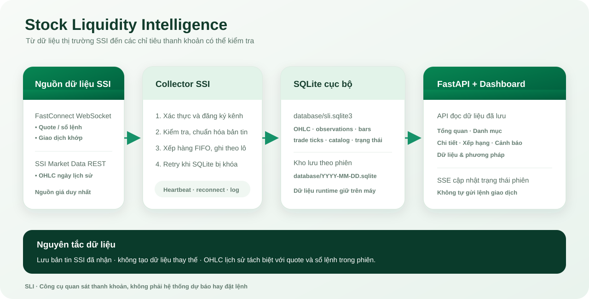
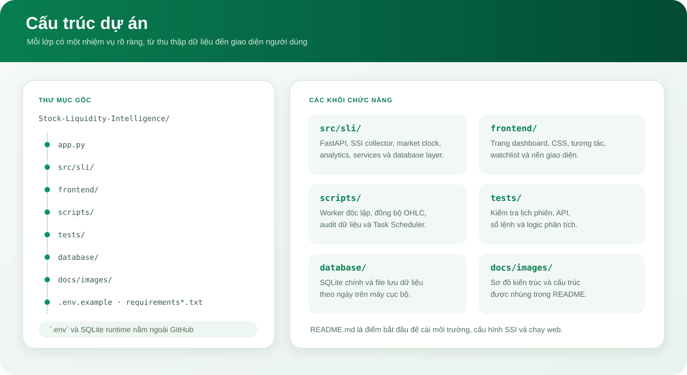

# Stock Liquidity Intelligence

> Dashboard nghiên cứu thanh khoản cổ phiếu Việt Nam từ dữ liệu SSI: theo dõi sổ lệnh, spread, độ sâu, giao dịch khớp và OHLC lịch sử.



## Dự án làm gì?

Stock Liquidity Intelligence (SLI) giúp nhà đầu tư quan sát điều kiện thanh khoản của từng mã và toàn thị trường qua nhiều góc nhìn:

- **Tổng quan:** độ rộng thị trường, giá trị/khối lượng giao dịch, bối cảnh OHLC và các biểu đồ thanh khoản.
- **Danh mục của tôi:** theo dõi mã, spread, độ sâu, trạng thái dữ liệu và ghi chú cục bộ.
- **Chi tiết cổ phiếu:** sổ lệnh gần nhất, spread, độ sâu, lịch sử trong phiên và mô phỏng đi bộ sổ lệnh trên snapshot.
- **Xếp hạng và cảnh báo:** sàng lọc theo dữ liệu đã lưu và baseline lịch sử của mã.
- **Dữ liệu & phương pháp:** trạng thái collector, độ phủ, thời điểm dữ liệu và cách tính chỉ tiêu.

Đây là công cụ quan sát và phân tích, **không dự báo giá, không đưa khuyến nghị mua/bán và không gửi lệnh giao dịch**.

## Dữ liệu và giới hạn

- Quote, sổ lệnh và giao dịch khớp được nhận từ **SSI FastConnect WebSocket**; OHLC ngày được đồng bộ từ **SSI Market Data REST**.
- Dữ liệu được chuẩn hóa và lưu trong SQLite cục bộ. `database/sli.sqlite3` là database truy vấn chính; các file `database/YYYY-MM-DD.sqlite` là bản lưu thô theo ngày.
- WebSocket gửi dữ liệu theo sự kiện. Mã không phát sinh cập nhật có thể không có quote mới trong một khoảng thời gian; SLI không tự điền dữ liệu giả để tạo độ phủ 100%.
- `connected` chỉ xác nhận kết nối. Hãy xem thêm thời điểm quote nhận/lưu gần nhất và trạng thái trong `/api/status`.
- OHLC lịch sử không thay thế dữ liệu sổ lệnh. Độ sâu và spread chỉ có khi SSI gửi snapshot tương ứng.
- Toàn bộ thời gian hiển thị dùng múi giờ `Asia/Ho_Chi_Minh`. Lịch phiên theo sàn được khai báo tập trung tại `src/sli/config.py`.

## Cấu trúc dự án



```text
.
├── app.py                   # Điểm khởi chạy FastAPI/Uvicorn
├── src/sli/                 # API, lịch phiên, collector, phân tích và SQLite
├── frontend/                # Dashboard HTML, CSS, JavaScript và tài nguyên tĩnh
├── scripts/                 # Worker SSI, tác vụ Windows và công cụ kiểm tra dữ liệu
├── tests/                   # Kiểm thử các logic backend
├── database/                # SQLite cục bộ (không đưa dữ liệu runtime lên GitHub)
├── docs/images/             # Hình minh họa kiến trúc và repository
├── .env.example             # Mẫu cấu hình; không chứa khóa thật
├── requirements.txt         # Dải phiên bản thư viện tương thích
└── requirements.lock       # Phiên bản thư viện đã khóa để cài lại ổn định
```

## Chạy trên Windows

### 1. Yêu cầu

- Python 3.10 trở lên
- PowerShell
- Khóa `SSI_API_KEY` và `SSI_API_SECRET` để nhận dữ liệu SSI thật. Có thể mở web khi chưa có khóa, nhưng collector SSI sẽ không kết nối.

### 2. Tạo môi trường và cài thư viện

Mở PowerShell tại thư mục gốc repository (thư mục có `app.py`).

```powershell
py -3 -m venv .venv
.\.venv\Scripts\python.exe -m pip install --upgrade pip
.\.venv\Scripts\python.exe -m pip install -r requirements.lock
```

Nếu `.venv` đã tồn tại và hoạt động, bỏ qua lệnh tạo môi trường. Có thể dùng `requirements.txt` nếu muốn cài các phiên bản tương thích thay vì các phiên bản đã khóa.

### 3. Cấu hình SSI

Tạo file cấu hình cục bộ:

```powershell
Copy-Item .env.example .env
notepad .env
```

Điền khóa vào `SSI_API_KEY` và `SSI_API_SECRET`. Giữ `DB_PATH=database/sli.sqlite3` nếu muốn dùng database mặc định. **Không commit `.env`, khóa SSI hoặc các file SQLite lên GitHub.** Các file này đã được đưa vào `.gitignore`.

### 4. Khởi chạy web

```powershell
.\.venv\Scripts\python.exe app.py
```

Mở <http://127.0.0.1:8000/>. Giữ cửa sổ terminal chạy web mở. Khi có đủ hai khóa SSI, backend sẽ tự khởi chạy worker nền. Trạng thái kiểm tra tại:

- <http://127.0.0.1:8000/api/status>
- <http://127.0.0.1:8000/api/market-clock>
- <http://127.0.0.1:8000/api/quality>
- <http://127.0.0.1:8000/api/collector/runs>

Nếu worker chưa chạy, có thể mở terminal thứ hai để khởi động thủ công:

```powershell
.\.venv\Scripts\python.exe scripts\ssi_worker.py
```

Worker có khóa chống chạy trùng. Trước khi chạy thủ công, kiểm tra `/api/status` để tránh mở thêm worker không cần thiết. Nhấn `Ctrl+C` trong terminal của worker để dừng worker; nhấn `Ctrl+C` trong terminal web để dừng web.

### Tự khởi chạy collector khi đăng nhập Windows

Tùy chọn này dùng Task Scheduler để chạy collector khi đăng nhập và lúc 08:45 từ thứ Hai đến thứ Sáu. Máy cần bật, đăng nhập và có kết nối mạng.

```powershell
Set-ExecutionPolicy -Scope Process -ExecutionPolicy RemoteSigned
.\scripts\install_daily_collector_task.ps1
```

Task Scheduler không lưu khóa SSI; worker đọc `.env`. Gỡ tác vụ:

```powershell
Unregister-ScheduledTask -TaskName "Stock Liquidity Intelligence - SSI Collector" -Confirm:$false
```

## Nếu cổng 8000 đang được sử dụng

`WinError 10048` nghĩa là một tiến trình đã chiếm `127.0.0.1:8000`; thường web cũ vẫn đang chạy. Mở <http://127.0.0.1:8000/> trước. Nếu cần khởi động lại, dừng web trong terminal cũ bằng `Ctrl+C`, rồi chạy lại một lần.

Để tìm tiến trình giữ cổng:

```powershell
netstat -ano | findstr :8000
tasklist /FI "PID eq <PID>"
```

Chỉ dừng tiến trình sau khi xác nhận đó là web của dự án. Nếu muốn dùng cổng khác:

```powershell
$env:SLI_PORT = "8001"
.\.venv\Scripts\python.exe app.py
```

Sau đó mở <http://127.0.0.1:8001/>.

## Đồng bộ lịch sử và vận hành dữ liệu

- Worker đồng bộ OHLC theo từng mã từ `HISTORY_START_DATE` (mặc định `2000/01/01`), phân trang và giãn cách yêu cầu theo cấu hình SSI.
- Đồng bộ OHLC đầy đủ chạy sau khi các sàn đóng cửa để tránh tranh chấp ghi với collector realtime.
- Quote và trade được lưu trong database chính và kho SQLite theo ngày. Các biểu đồ đọc dữ liệu đã chuẩn hóa trong database chính.
- Khi database không có bar cho một mã/phút, điều đó không tự động có nghĩa là lỗi ghi: nguồn có thể không gửi cập nhật cho mã đó trong phút ấy.
- Lịch sử xếp hạng, spread và độ sâu phụ thuộc vào dữ liệu thực tế đã thu thập. Không thể khôi phục dữ liệu WebSocket của những phiên máy không chạy collector.

## Cấu hình thường dùng

Các giá trị có thể đặt trong `.env`; xem đầy đủ tên và chú thích trong `.env.example`.

| Biến | Mặc định | Ý nghĩa |
|---|---:|---|
| `DB_PATH` | `database/sli.sqlite3` | Đường dẫn database SQLite chính |
| `SLI_HOST` | `127.0.0.1` | Địa chỉ web server lắng nghe |
| `SLI_PORT` | `8000` | Cổng web server |
| `HISTORY_START_DATE` | `2000/01/01` | Ngày bắt đầu yêu cầu OHLC lịch sử từ SSI |
| `MARKET_HOLIDAYS` | *(trống)* | Ngày nghỉ đã xác nhận, phân cách bằng dấu phẩy |
| `MARKET_CLOCK_OVERRIDE` | *(trống)* | Chỉ dùng giả lập đồng hồ khi kiểm tra giao diện; để trống khi chạy thật |

## Phát triển và kiểm thử

Cài thêm công cụ phát triển nếu cần:

```powershell
.\.venv\Scripts\python.exe -m pip install -r requirements-dev.txt
.\.venv\Scripts\python.exe -m pytest
```

Các kiểm thử không cần khóa SSI; việc lấy dữ liệu thật cần thông tin xác thực FastConnect hợp lệ trong `.env`.
